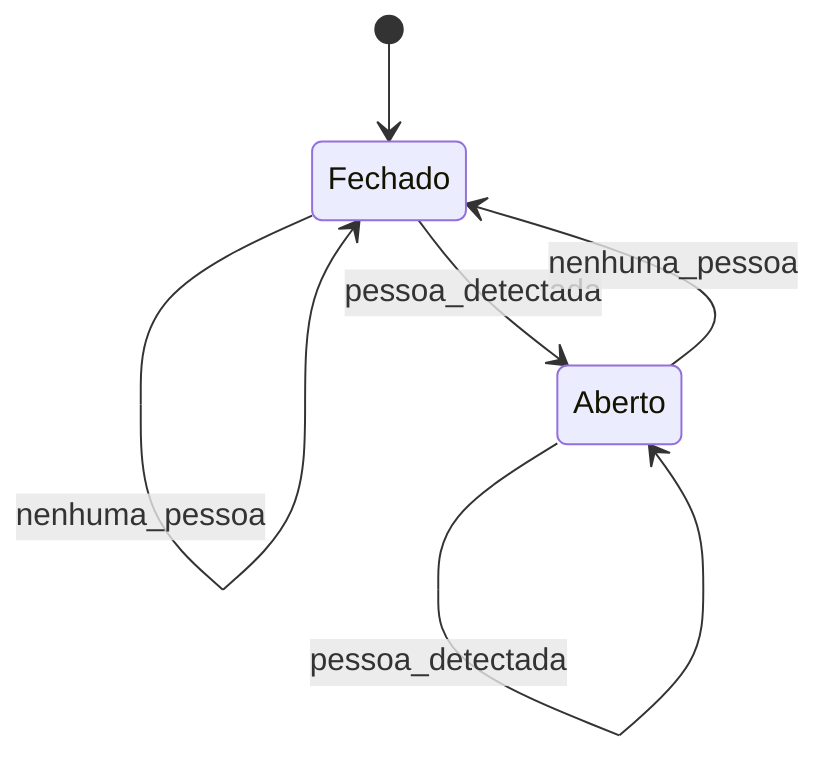
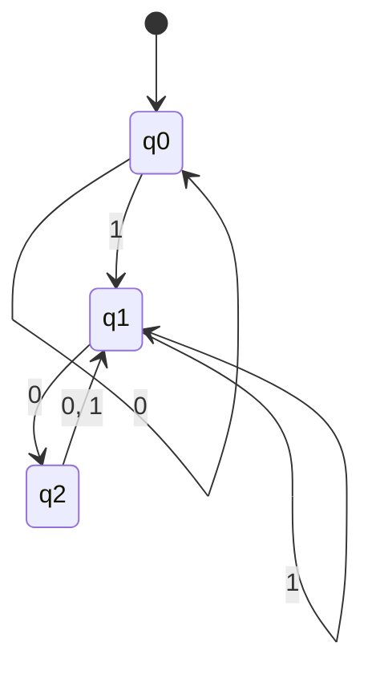
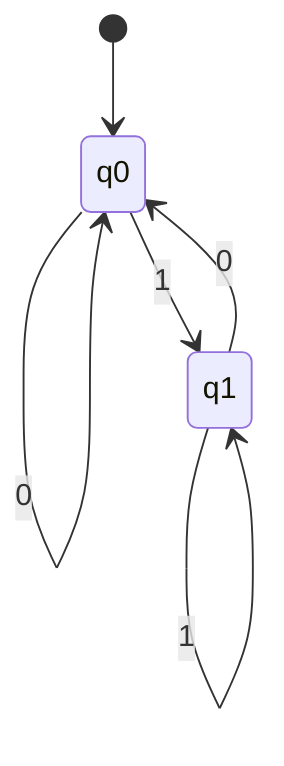
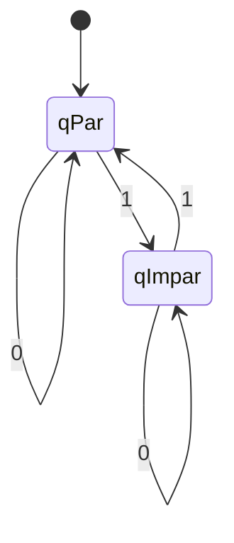
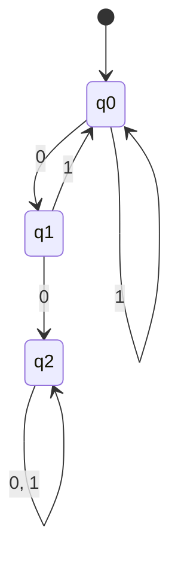
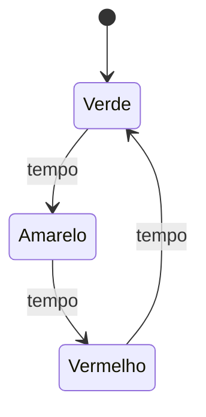
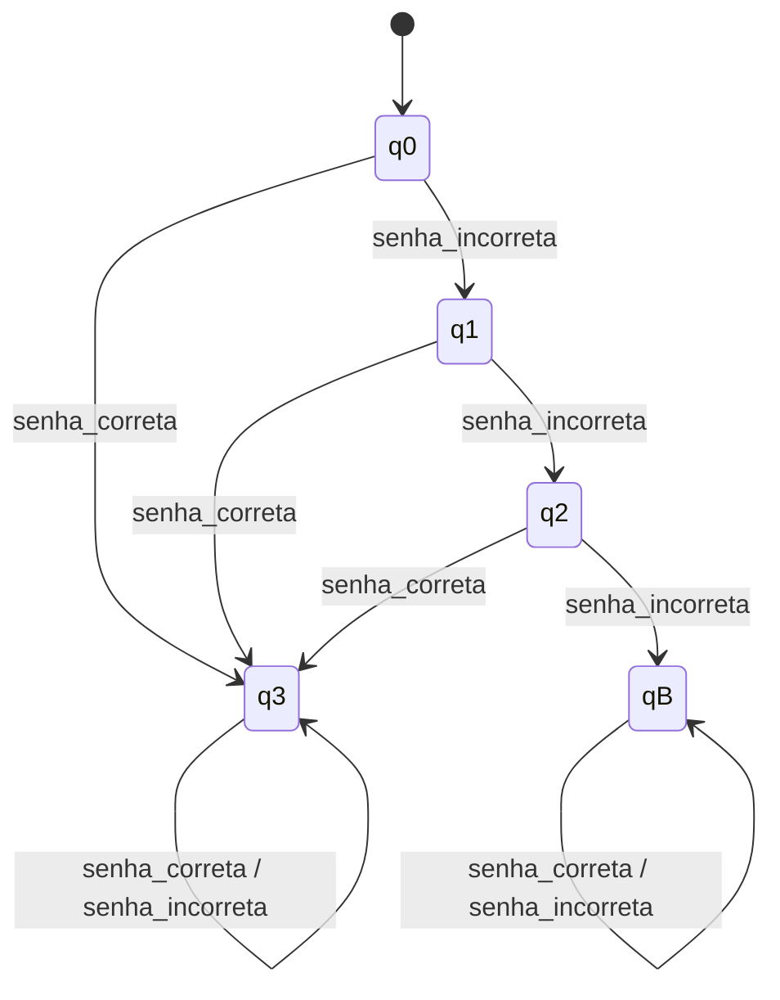
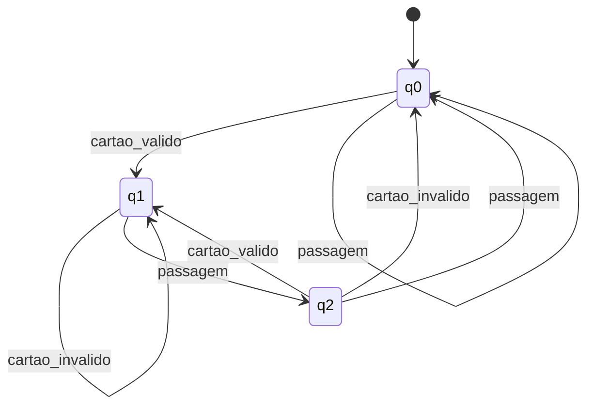

# Lista de Exercícios — Autômatos Finitos Determinísticos (AFD)

> **Disciplina:** Teoria das Linguagens e Autômatos
> **Tema:** Autômatos Finitos Determinísticos
> **Modalidade:** Atividade prática em grupo
> **Objetivo:** identificar, interpretar, construir e testar AFDs.

---

## Identificação do grupo

| Campo        | Preenchimento                   |
| ------------ | ------------------------------- |
| Turma        | N1                              |
| Data         | 08/09/2026                                |
| Integrante 1 | Marcos Vinicius De Souza Duarte |


## Orientações

* Registre o raciocínio utilizado em cada resposta.
* Nos exercícios com cadeias, apresente o caminho percorrido estado por estado.
* Nos exercícios de construção, entregue a quíntupla, a tabela de transição e o diagrama.
* Use `ε` para representar a cadeia vazia.
* Quando solicitado, implemente e teste o autômato no JFLAP.

---

# Parte 1 — Fundamentos

## Exercício 1 — Entendendo um autômato finito

Uma lâmpada controlada por um interruptor possui os estados `Desligado` e `Ligado`. Sempre que o botão é pressionado, ocorre a mudança:

```text
Desligado --pressionar--> Ligado
Ligado    --pressionar--> Desligado
```

Responda:

1. Quantos estados existem?

**Resposta:** Existem 2 estados: `Desligado` e `Ligado`.

2. Qual é o estado inicial, considerando que a lâmpada começa apagada?

**Resposta:** O estado inicial é `Desligado`.

3. Qual entrada provoca uma transição?

**Resposta:** A entrada `pressionar` provoca uma transição.

4. Partindo de `Desligado`, qual será o estado após um acionamento?

**Resposta:** Após um acionamento, a lâmpada estará em `Ligado`.

5. Partindo de `Desligado`, qual será o estado após dois acionamentos?

**Resposta:** Após dois acionamentos, a lâmpada estará novamente em `Desligado`.

6. Explique o funcionamento do sistema com suas palavras.

**Resposta:** O autômato representa o funcionamento de uma lâmpada controlada por um interruptor. Sempre que a entrada `pressionar` ocorre, o estado muda para o estado oposto. Assim, se estiver `Desligado`, passa para `Ligado`, e se estiver `Ligado`, passa para `Desligado`.

## Exercício 2 — Porta automática

Uma porta automática possui os estados `Fechado` e `Aberto`. O sensor identifica `pessoa_detectada` ou `nenhuma_pessoa`. Quando uma pessoa é detectada, a porta deve ficar aberta; quando ninguém é detectado, deve ficar fechada.

Complete a tabela:

| Estado atual | Entrada          | Próximo estado |
| ------------ | ---------------- | -------------- |
| Fechado      | pessoa_detectada | Aberto         |
| Fechado      | nenhuma_pessoa   | Fechado        |
| Aberto       | pessoa_detectada | Aberto         |
| Aberto       | nenhuma_pessoa   | Fechado        |

Depois, desenhe o diagrama de estados correspondente e indique o estado inicial.

**Estado inicial:** `Fechado`.



---

# Parte 2 — Anatomia e definição formal

## Exercício 3 — Identificando os elementos

Considere um AFD com `Σ = {0,1}`, `Q = {q0,q1}`, estado inicial `q0`, estado final `q1` e as transições abaixo:

| δ  | 0  | 1  |
| -- | -- | -- |
| q0 | q0 | q1 |
| q1 | q0 | q1 |

Identifique e explique:

1. o alfabeto `Σ`;

**Resposta:** `Σ = {0,1}`. É o conjunto de símbolos que podem ser utilizados como entrada no autômato.

2. o conjunto de estados `Q`;

**Resposta:** `Q = {q0,q1}`.

3. o estado inicial;

**Resposta:** O estado inicial é `q0`.

4. o conjunto de estados finais `F`;

**Resposta:** `F = {q1}`.

5. os símbolos que podem ser lidos;

**Resposta:** Os símbolos que podem ser lidos são `0` e `1`.

6. o significado do círculo duplo em um diagrama;

**Resposta:** O círculo duplo representa um estado final ou de aceitação.

7. o significado da seta sem origem apontando para um estado.

**Resposta:** A seta sem origem indica o estado inicial do autômato.

## Exercício 4 — A quíntupla do AFD

Um AFD é formalmente representado por:

```text
M = (Σ, Q, δ, q0, F)
```

Complete:

| Elemento | Significado                                |
| -------- | ------------------------------------------ |
| `Σ`      | Alfabeto de entrada                        |
| `Q`      | Conjunto finito de estados                 |
| `δ`      | Função de transição                        |
| `q0`     | Estado inicial                             |
| `F`      | Conjunto de estados finais ou de aceitação |

Explique por que esses cinco elementos são suficientes para definir o funcionamento de um AFD.

**Resposta:** Esses cinco elementos são suficientes porque definem todos os componentes necessários para o funcionamento do autômato: os símbolos que podem ser lidos (`Σ`), os estados existentes (`Q`), as regras que determinam para qual estado o autômato vai após cada entrada (`δ`), onde o processamento começa (`q0`) e quais estados representam aceitação (`F`).

---

# Parte 3 — Tabela de transições e cadeias

## Exercício 5 — Interpretando uma tabela

Considere `Σ = {0,1}`, `Q = {q0,q1,q2}`, estado inicial `q0`, `F = {q1}` e:

| δ  | 0  | 1  |
| -- | -- | -- |
| q0 | q0 | q1 |
| q1 | q2 | q1 |
| q2 | q1 | q1 |

Responda:

1. Qual é o resultado de `δ(q0,0)`?

**Resposta:** `δ(q0,0) = q0`.

2. Qual é o resultado de `δ(q0,1)`?

**Resposta:** `δ(q0,1) = q1`.

3. Qual é o resultado de `δ(q1,0)`?

**Resposta:** `δ(q1,0) = q2`.

4. Qual é o resultado de `δ(q2,1)`?

**Resposta:** `δ(q2,1) = q1`.

5. Qual é o estado de aceitação?

**Resposta:** O estado de aceitação é `q1`.

6. Desenhe o diagrama correspondente à tabela.



7. Justifique por que o autômato é determinístico.

**Resposta:** O autômato é determinístico porque, para cada estado e cada símbolo de entrada, existe exatamente uma transição possível para um único próximo estado.

## Exercício 6 — Aceita ou rejeita?

Utilize o AFD do Exercício 5. Determine se cada cadeia é aceita ou rejeitada:

```text
a) 1
b) 0011001
c) 010010
d) 1101
e) 000011010
```

Para cada cadeia, registre todas as transições. Exemplo:

```text
Cadeia: 01
q0 --0--> q0
q0 --1--> q1
Estado final: q1
Resultado: ACEITA
```

| Cadeia      | Caminho percorrido                                                                             | Estado final | Resultado |
| ----------- | ---------------------------------------------------------------------------------------------- | ------------ | --------- |
| `1`         | `q0 --1--> q1`                                                                                 | `q1`         | ACEITA    |
| `0011001`   | `q0 --0--> q0 --0--> q0 --1--> q1 --1--> q1 --0--> q2 --0--> q1 --1--> q1`                     | `q1`         | ACEITA    |
| `010010`    | `q0 --0--> q0 --1--> q1 --0--> q2 --0--> q1 --1--> q1 --0--> q2`                               | `q2`         | REJEITA   |
| `1101`      | `q0 --1--> q1 --1--> q1 --0--> q2 --1--> q1`                                                   | `q1`         | ACEITA    |
| `000011010` | `q0 --0--> q0 --0--> q0 --0--> q0 --0--> q0 --1--> q1 --1--> q1 --0--> q2 --1--> q1 --0--> q2` | `q2`         | REJEITA   |

---

# Parte 4 — Construção de AFDs

## Exercício 7 — Cadeias que terminam em `1`

Construa um AFD sobre `Σ = {0,1}` que reconheça todas as cadeias que terminam em `1`.

* Devem ser aceitas: `1`, `01`, `101`, `0001`, `1101`.
* Devem ser rejeitadas: `ε`, `0`, `10`, `100`, `1110`.

Entregue: conjunto de estados, alfabeto, estado inicial, estados finais, tabela, diagrama e teste de pelo menos cinco cadeias.

**Definição formal:**

```text
M = (Σ, Q, δ, q0, F)

Σ = {0,1}
Q = {q0,q1}
q0 = estado inicial
F = {q1}
```

Onde `q0` representa uma cadeia que não termina em `1` e `q1` representa uma cadeia que termina em `1`.

| δ  | 0  | 1  |
| -- | -- | -- |
| q0 | q0 | q1 |
| q1 | q0 | q1 |



**Testes:**

| Cadeia | Caminho                                      | Resultado |
| ------ | -------------------------------------------- | --------- |
| `1`    | `q0 --1--> q1`                               | ACEITA    |
| `01`   | `q0 --0--> q0 --1--> q1`                     | ACEITA    |
| `101`  | `q0 --1--> q1 --0--> q0 --1--> q1`           | ACEITA    |
| `0001` | `q0 --0--> q0 --0--> q0 --0--> q0 --1--> q1` | ACEITA    |
| `1101` | `q0 --1--> q1 --1--> q1 --0--> q0 --1--> q1` | ACEITA    |
| `ε`    | `q0`                                         | REJEITA   |
| `0`    | `q0 --0--> q0`                               | REJEITA   |
| `10`   | `q0 --1--> q1 --0--> q0`                     | REJEITA   |
| `100`  | `q0 --1--> q1 --0--> q0 --0--> q0`           | REJEITA   |
| `1110` | `q0 --1--> q1 --1--> q1 --1--> q1 --0--> q0` | REJEITA   |

## Exercício 8 — Número par de símbolos `1`

Construa um AFD sobre `Σ = {0,1}` que reconheça cadeias com quantidade par de símbolos `1`.

Analise: `ε`, `0`, `1`, `11`, `101`, `1100` e `10101`.

Apresente a definição formal `M = (Σ, Q, δ, q0, F)`, a tabela, o diagrama e o processamento das cadeias. Lembre-se de que basta controlar duas situações: quantidade par ou ímpar de símbolos `1`.

**Definição formal:**

```text
M = (Σ, Q, δ, q0, F)

Σ = {0,1}
Q = {qPar,qImpar}
q0 = qPar
F = {qPar}
```

| δ      | 0      | 1      |
| ------ | ------ | ------ |
| qPar   | qPar   | qImpar |
| qImpar | qImpar | qPar   |



**Processamento das cadeias:**

| Cadeia  | Caminho                                                                  | Resultado |
| ------- | ------------------------------------------------------------------------ | --------- |
| `ε`     | `qPar`                                                                   | ACEITA    |
| `0`     | `qPar --0--> qPar`                                                       | ACEITA    |
| `1`     | `qPar --1--> qImpar`                                                     | REJEITA   |
| `11`    | `qPar --1--> qImpar --1--> qPar`                                         | ACEITA    |
| `101`   | `qPar --1--> qImpar --0--> qImpar --1--> qPar`                           | ACEITA    |
| `1100`  | `qPar --1--> qImpar --1--> qPar --0--> qPar --0--> qPar`                 | ACEITA    |
| `10101` | `qPar --1--> qImpar --0--> qImpar --1--> qPar --0--> qPar --1--> qImpar` | REJEITA   |

## Exercício 9 — Pelo menos dois zeros consecutivos

Construa um AFD para:

```text
L(M) = {w ∈ {0,1}* | w possui pelo menos dois 0s consecutivos}
```

* Devem ser aceitas: `00`, `001`, `100`, `1001`, `110011`, `0000`.
* Devem ser rejeitadas: `ε`, `0`, `1`, `01`, `10`, `10101`.

Responda antes de construir:

1. O que o estado inicial representa?

**Resposta:** O estado inicial `q0` representa que ainda não foram encontrados dois zeros consecutivos e que o último símbolo não é um `0`.

2. O que ocorre quando aparece o primeiro `0`?

**Resposta:** O autômato vai de `q0` para `q1`, indicando que foi encontrado um primeiro `0`.

3. O que ocorre quando outro `0` aparece imediatamente depois?

**Resposta:** O autômato vai de `q1` para `q2`, indicando que foram encontrados dois zeros consecutivos.

4. Depois de encontrar `00`, a cadeia pode deixar de ser aceita?

**Resposta:** Não. Depois de encontrar `00`, o estado `q2` permanece final independentemente dos próximos símbolos.

5. Quantos estados são necessários?

**Resposta:** São necessários 3 estados: `q0`, `q1` e `q2`.

Apresente a quíntupla, a tabela, o diagrama e os testes.

**Definição formal:**

```text
M = (Σ, Q, δ, q0, F)

Σ = {0,1}
Q = {q0,q1,q2}
q0 = estado inicial
F = {q2}
```

| δ  | 0  | 1  |
| -- | -- | -- |
| q0 | q1 | q0 |
| q1 | q2 | q0 |
| q2 | q2 | q2 |



**Testes:**

| Cadeia   | Caminho                                                          | Resultado |
| -------- | ---------------------------------------------------------------- | --------- |
| `00`     | `q0 --0--> q1 --0--> q2`                                         | ACEITA    |
| `001`    | `q0 --0--> q1 --0--> q2 --1--> q2`                               | ACEITA    |
| `100`    | `q0 --1--> q0 --0--> q1 --0--> q2`                               | ACEITA    |
| `1001`   | `q0 --1--> q0 --0--> q1 --0--> q2 --1--> q2`                     | ACEITA    |
| `110011` | `q0 --1--> q0 --1--> q0 --0--> q1 --0--> q2 --1--> q2 --1--> q2` | ACEITA    |
| `0000`   | `q0 --0--> q1 --0--> q2 --0--> q2 --0--> q2`                     | ACEITA    |
| `ε`      | `q0`                                                             | REJEITA   |
| `0`      | `q0 --0--> q1`                                                   | REJEITA   |
| `1`      | `q0 --1--> q0`                                                   | REJEITA   |
| `01`     | `q0 --0--> q1 --1--> q0`                                         | REJEITA   |
| `10`     | `q0 --1--> q0 --0--> q1`                                         | REJEITA   |
| `10101`  | `q0 --1--> q0 --0--> q1 --1--> q0 --0--> q1 --1--> q0`           | REJEITA   |

---

# Parte 5 — Desafios de modelagem

## Exercício 10 — Semáforo

Modele um semáforo com os estados `Verde`, `Amarelo` e `Vermelho`. Use a entrada `tempo` e represente o ciclo:

```text
Verde → Amarelo → Vermelho → Verde
```

Entregue o diagrama, a tabela de transições, a definição formal e uma explicação do funcionamento. Discuta se há sentido em definir estados de aceitação nesse modelo e justifique a escolha adotada.

**Definição formal:**

```text
M = (Σ, Q, δ, q0, F)

Σ = {tempo}
Q = {Verde, Amarelo, Vermelho}
q0 = Verde
F = ∅
```

**Tabela de transições:**

| Estado atual | Entrada | Próximo estado |
| ------------ | ------- | -------------- |
| Verde        | tempo   | Amarelo        |
| Amarelo      | tempo   | Vermelho       |
| Vermelho     | tempo   | Verde          |



**Explicação:** O semáforo começa no estado `Verde`. A cada entrada `tempo`, passa para o próximo estado do ciclo: `Verde` para `Amarelo`, `Amarelo` para `Vermelho` e `Vermelho` novamente para `Verde`.

**Estados de aceitação:** Nesse modelo, os estados de aceitação não possuem uma função importante, pois o objetivo é representar o funcionamento cíclico do semáforo e não reconhecer uma linguagem. Por isso, foi utilizado `F = ∅`.

## Exercício 11 — Sistema de login

Modele um sistema com as entradas `senha_correta` e `senha_incorreta`. Uma senha correta autentica o usuário; após três tentativas incorretas, o sistema fica bloqueado.

Determine:

1. todos os estados necessários para contar as tentativas;

**Resposta:** São necessários os estados `q0`, `q1` e `q2` para representar, respectivamente, 0, 1 e 2 tentativas incorretas. Também são necessários `q3` para `Autenticado` e `qB` para `Bloqueado`.

2. o alfabeto de entrada;

**Resposta:**

```text
Σ = {senha_correta, senha_incorreta}
```

3. o estado inicial;

**Resposta:** O estado inicial é `q0`, que representa nenhuma tentativa incorreta.

4. os estados finais;

**Resposta:** O estado final é `q3`, que representa o usuário autenticado.

5. todas as transições;

| Estado atual | senha_correta | senha_incorreta |
| ------------ | ------------- | --------------- |
| q0           | q3            | q1              |
| q1           | q3            | q2              |
| q2           | q3            | qB              |
| q3           | q3            | q3              |
| qB           | qB            | qB              |

6. o comportamento após a autenticação e após o bloqueio.

**Resposta:** Após a autenticação, o sistema permanece em `q3`, independentemente das entradas recebidas. Após o bloqueio, o sistema permanece em `qB` e não pode voltar aos estados anteriores.

Responda: apenas os estados `Aguardando`, `Autenticado` e `Bloqueado` são suficientes para controlar três tentativas? Justifique e construa o AFD completo.

**Resposta:** Não. Esses três estados não são suficientes porque o sistema precisa saber quantas tentativas incorretas já ocorreram antes do bloqueio. É necessário diferenciar 0, 1 e 2 tentativas incorretas. Assim, são usados `q0`, `q1`, `q2`, `q3` e `qB`.

**Definição formal:**

```text
M = (Σ, Q, δ, q0, F)

Σ = {senha_correta, senha_incorreta}
Q = {q0,q1,q2,q3,qB}
q0 = q0
F = {q3}
```



---

# Parte 6 — Prática no JFLAP

## Exercício 12 — Implementação e testes

Escolha um dos AFDs dos exercícios 7, 8 ou 9 e implemente-o no JFLAP.

1. Crie os estados.
2. Defina o estado inicial e os estados finais.
3. Crie todas as transições.
4. Teste três cadeias que devem ser aceitas.
5. Teste três cadeias que devem ser rejeitadas.
6. Compare os resultados esperados e obtidos.

**AFD escolhido:** Exercício 7 — Cadeias que terminam em `1`.

| Cadeia | Resultado esperado | Resultado no JFLAP | Conferência |
| ------ | ------------------ | ------------------ | ----------- |
| `1`    | ACEITA             | ACEITA             | ✓           |
| `01`   | ACEITA             | ACEITA             | ✓           |
| `101`  | ACEITA             | ACEITA             | ✓           |
| `0`    | REJEITA            | REJEITA            | ✓           |
| `10`   | REJEITA            | REJEITA            | ✓           |
| `1110` | REJEITA            | REJEITA            | ✓           |

Inclua um print do AFD, a tabela de testes e uma breve explicação.

**Explicação:** O AFD foi escolhido por possuir apenas dois estados. O estado `q0` representa que a cadeia não termina em `1`, enquanto `q1` representa que a cadeia termina em `1`. Os resultados dos testes correspondem ao comportamento esperado do autômato.

**Print do AFD no JFLAP:** inserir aqui o print da implementação realizada no JFLAP.

---

# Desafio final

## Exercício 13 — Crie seu próprio problema

Escolha uma situação real representável por estados, como elevador, máquina de vendas, controle de acesso, estacionamento, pedido de delivery, semáforo, porta eletrônica ou protocolo de comunicação.

O grupo deverá:

1. descrever o problema e suas regras;
2. identificar as entradas e os estados;
3. definir o estado inicial e os estados finais;
4. criar a tabela de transições;
5. desenhar o AFD;
6. apresentar `M = (Σ, Q, δ, q0, F)`;
7. testar pelo menos cinco sequências de entrada;
8. explicar por que o modelo é determinístico;
9. apresentar uma conclusão sobre o que foi aprendido.

**Problema escolhido:** Controle de acesso por catraca eletrônica.

**Regras:** A catraca começa bloqueada. Quando recebe um cartão válido, fica liberada. Quando uma pessoa passa pela catraca, ela volta a ficar bloqueada. Um cartão inválido não libera a catraca.

**Estados e significado:**

```text
q0 = Bloqueada
q1 = Liberada
q2 = Passagem realizada
```

**Alfabeto:**

```text
Σ = {cartao_valido, cartao_invalido, passagem}
```

**Estado inicial e estados finais:**

```text
q0 = estado inicial
F = {q2}
```

**Tabela de transições:**

| δ  | cartao_valido | cartao_invalido | passagem |
| -- | ------------- | --------------- | -------- |
| q0 | q1            | q0              | q0       |
| q1 | q1            | q1              | q2       |
| q2 | q1            | q0              | q0       |

**Diagrama:**



**Definição formal:**

```text
M = (Σ, Q, δ, q0, F)

Σ = {cartao_valido, cartao_invalido, passagem}
Q = {q0,q1,q2}
q0 = q0
F = {q2}
```

**Testes realizados:**

| Entrada                                    | Resultado esperado | Resultado obtido |
| ------------------------------------------ | ------------------ | ---------------- |
| `cartao_valido, passagem`                  | ACEITA             | ACEITA           |
| `cartao_invalido`                          | REJEITA            | REJEITA          |
| `cartao_valido, cartao_invalido, passagem` | ACEITA             | ACEITA           |
| `passagem`                                 | REJEITA            | REJEITA          |
| `cartao_invalido, cartao_valido, passagem` | ACEITA             | ACEITA           |

**Processamento dos testes:**

```text
1. cartao_valido, passagem
q0 --cartao_valido--> q1
q1 --passagem--> q2
Resultado: ACEITA

2. cartao_invalido
q0 --cartao_invalido--> q0
Resultado: REJEITA

3. cartao_valido, cartao_invalido, passagem
q0 --cartao_valido--> q1
q1 --cartao_invalido--> q1
q1 --passagem--> q2
Resultado: ACEITA

4. passagem
q0 --passagem--> q0
Resultado: REJEITA

5. cartao_invalido, cartao_valido, passagem
q0 --cartao_invalido--> q0
q0 --cartao_valido--> q1
q1 --passagem--> q2
Resultado: ACEITA
```

**Por que o modelo é determinístico:** O modelo é determinístico porque, para cada estado e cada entrada possível, existe exatamente uma transição para um único próximo estado.

**Conclusão:** A atividade permitiu compreender como os AFDs representam sistemas por meio de estados, entradas e transições. Também foi possível aprender a construir a quíntupla formal, montar tabelas de transição, acompanhar o processamento de cadeias e identificar quando uma cadeia é aceita ou rejeitada. O exercício também mostrou como um AFD pode representar situações do cotidiano, como o controle de acesso de uma catraca.

---

# Entregável

O grupo deverá entregar um único arquivo `README.md`, contendo:

* identificação do grupo;
* respostas dos exercícios indicados pela professora;
* diagramas e tabelas de transição;
* processamento estado por estado das cadeias;
* evidência dos testes no JFLAP;
* conclusão do grupo.

## Modelo para o desafio final

```markdown
## Desafio final

### Problema escolhido

### Estados e significado

### Alfabeto

### Estado inicial e estados finais

### Tabela de transições

### Diagrama

### Definição formal
M = (Σ, Q, δ, q0, F)

### Testes realizados
| Entrada | Resultado esperado | Resultado obtido |
|---|---|---|
| | | |

### Evidência no JFLAP


### Conclusão
```

> **Importante:** não basta apresentar o diagrama. Demonstre como o AFD processa cada cadeia, estado por estado, até decidir pela aceitação ou rejeição.

---

**Profa. Kadidja Valéria**
